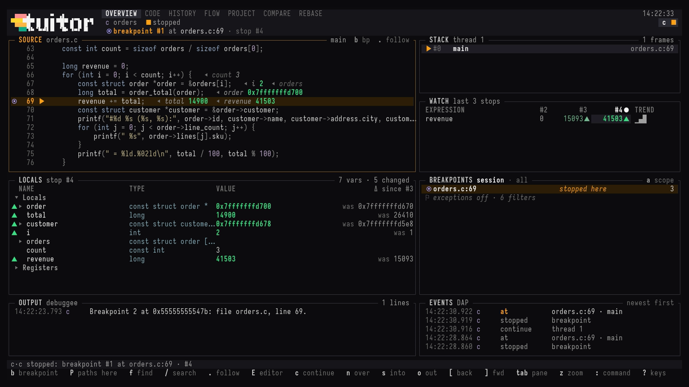
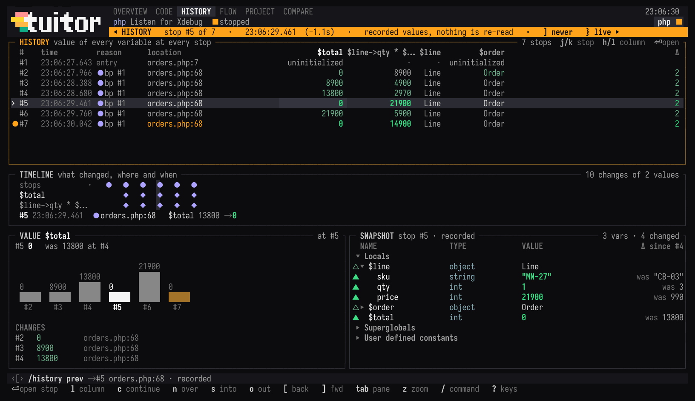
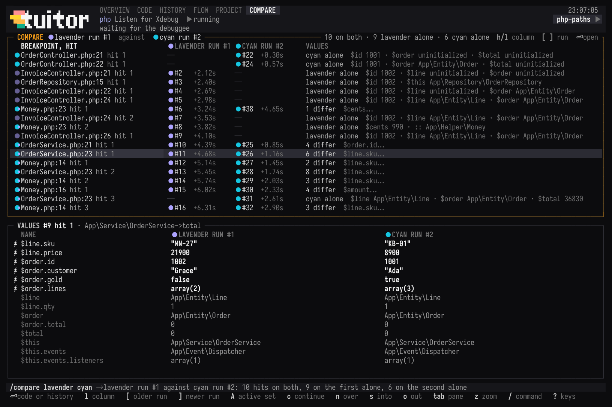
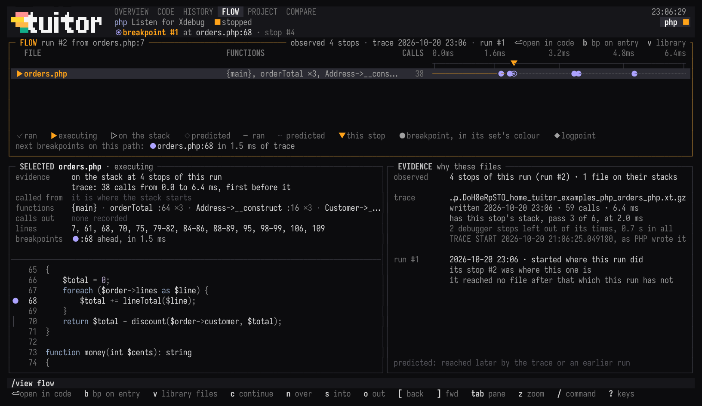
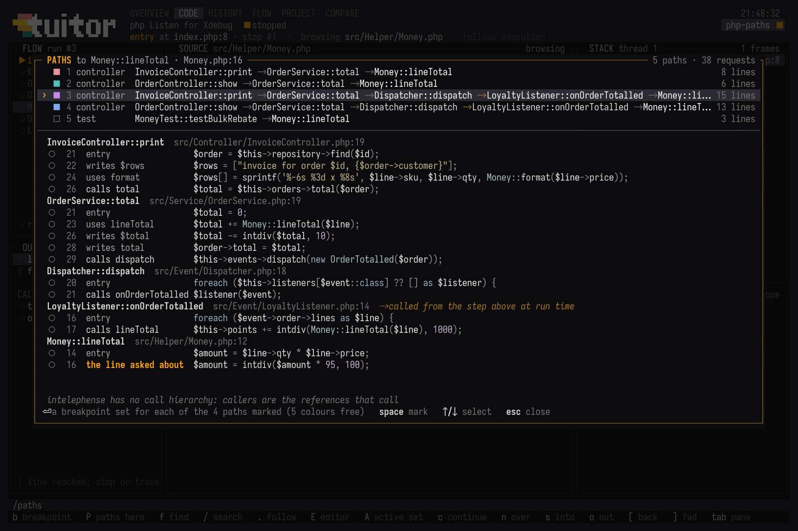

<picture>
  <source media="(prefers-color-scheme: dark)" srcset="assets/logo_white.svg">
  <source media="(prefers-color-scheme: light)" srcset="assets/logo_black.svg">
  
</picture>

**A terminal debugger for every language: it records every stop, so you can step back and compare runs.**

[](https://github.com/DorianDevp/tuitor/actions/workflows/ci.yml)
[](https://crates.io/crates/tuitor)
[](LICENSE)
[](https://doriandevp.github.io/tuitor/)

[](https://doriandevp.github.io/tuitor/)

▶ [Watch the 30-second demo](https://doriandevp.github.io/tuitor/)

tuitor is a [Debug Adapter Protocol](https://microsoft.github.io/debug-adapter-protocol/) client.
One terminal program debugs PHP, JavaScript, TypeScript, Go, C, C++, Rust, Zig and Dockerfile
builds, using the same adapters as VS Code.

- **Uses your `.vscode/launch.json`.** No new config format.
- **Records every stop.** Step back with `[` and `]`, see every variable at every stop, find when a
  value went wrong.
- **Breakpoint sets.** One set stops the program, the others record and let it run. COMPARE lines up
  two runs, also across commits.
- **Debugs Dockerfile builds** and tells you why a step failed.
- **Works with your editor.** Open the current line in Neovim, Vim, Helix, VS Code, Zed, Emacs,
  Kakoune, Sublime or JetBrains, and set breakpoints from it. See [Editors](https://doriandevp.github.io/tuitor/editors.html).
- **One ~9 MB binary.** No GUI; works over SSH and in tmux.

## Install

```sh
cargo install tuitor --locked           # crates.io
cargo binstall tuitor                   # prebuilt binary
brew install DorianDevp/tuitor/tuitor   # Homebrew
yay -S tuitor-bin                       # Arch Linux (AUR); tuitor builds from source
nix run github:DorianDevp/tuitor        # Nix
```

Binaries for Linux and macOS are on [GitHub Releases](https://github.com/DorianDevp/tuitor/releases).
From a clone: `cargo install --path crates/tuitor`.

### Installing adapters

tuitor runs adapters; it does not bundle them. `tuitor doctor` shows what is missing and how to fix it.

| language | adapter | install |
|---|---|---|
| PHP | vscode-php-debug + Xdebug 3 | `tuitor install php`, Xdebug from your distribution |
| JavaScript, TypeScript (Node.js, Chrome) | js-debug | `tuitor install js-debug` |
| Go | Delve | `tuitor install delve` |
| C, C++, Rust, Zig | gdb 14+, lldb-dap or CodeLLDB | distribution package, or `tuitor install codelldb` |
| Dockerfile | BuildKit (`docker buildx` 0.38+) | Docker |

Other adapters can be added in `adapters.toml`. Details: [Adapters](https://doriandevp.github.io/tuitor/adapters.html).

## Quick start

```sh
cd examples/go && ./run.sh        # or php, js, typescript, web, angular, c, rust
```

1. `f`, type `main.go:58`, `ctrl-b`, `esc`: set a breakpoint.
2. `c`: run to it. `c` again: changed values turn green with `▲` and the old value.
3. `s` `n` `o`: step in, over, out. `w`: watch a variable.
4. `[` `]`: step back and forth through recorded stops. `g h`: every variable at every stop.
5. `?`: every command. `Q`: quit.

On your own code:

```sh
tuitor                                    # this directory's project
tuitor "Listen for Xdebug"                # a launch configuration by name
tuitor exec ./target/debug/app -- --flag  # a native program, through gdb
tuitor listen --map /var/www/app=./api    # PHP in Docker, on port 9003
tuitor build api/Dockerfile               # a Dockerfile build
```

Guides: [PHP](https://doriandevp.github.io/tuitor/guides/php.html) ·
[PHP in Docker](https://doriandevp.github.io/tuitor/guides/php-docker.html) ·
[Node.js and TypeScript](https://doriandevp.github.io/tuitor/guides/node.html) ·
[Chrome](https://doriandevp.github.io/tuitor/guides/browser.html) ·
[Go](https://doriandevp.github.io/tuitor/guides/go.html) ·
[C, C++, Rust, Zig](https://doriandevp.github.io/tuitor/guides/native.html) ·
[Dockerfile](https://doriandevp.github.io/tuitor/guides/dockerfile.html)

## Screenshots

| | |
|---|---|
|  |  |
| **HISTORY**: every variable at every stop | **COMPARE**: two runs, value by value |
|  |  |
| **FLOW**: the files a run went through | **PATHS**: call trees through a line |

## Documentation

**[doriandevp.github.io/tuitor](https://doriandevp.github.io/tuitor/)**: features, keys,
configuration, adapters, [comparisons](https://doriandevp.github.io/tuitor/vs/nvim-dap.html),
[FAQ](https://doriandevp.github.io/tuitor/faq.html) and
[limitations](https://doriandevp.github.io/tuitor/limitations.html).

## Contributing

Bug reports, adapters and language servers are welcome. See [CONTRIBUTING.md](CONTRIBUTING.md).

## License

[MIT](LICENSE)
