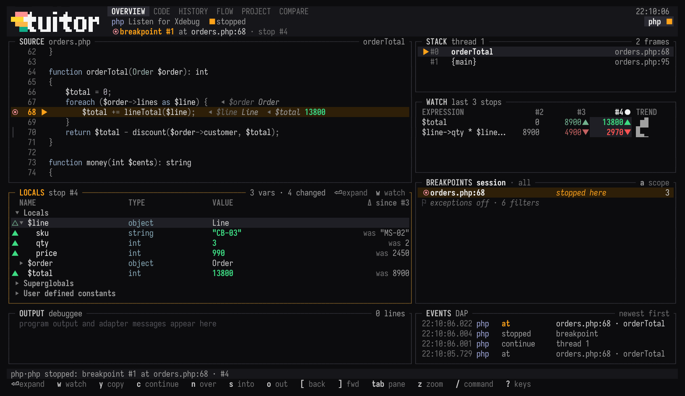
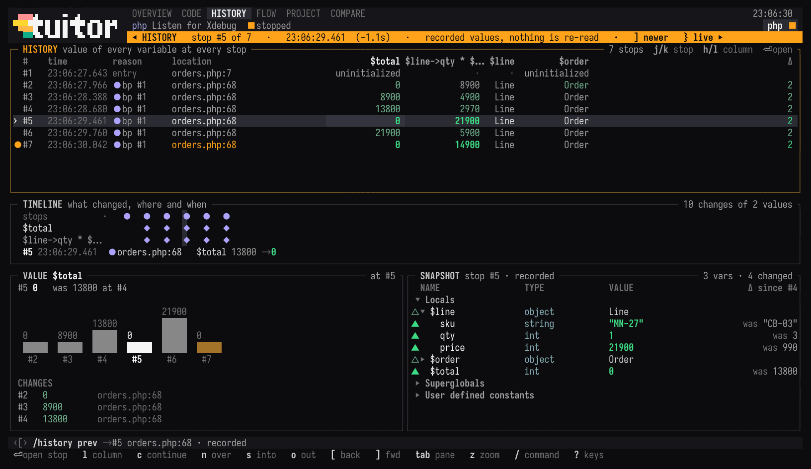
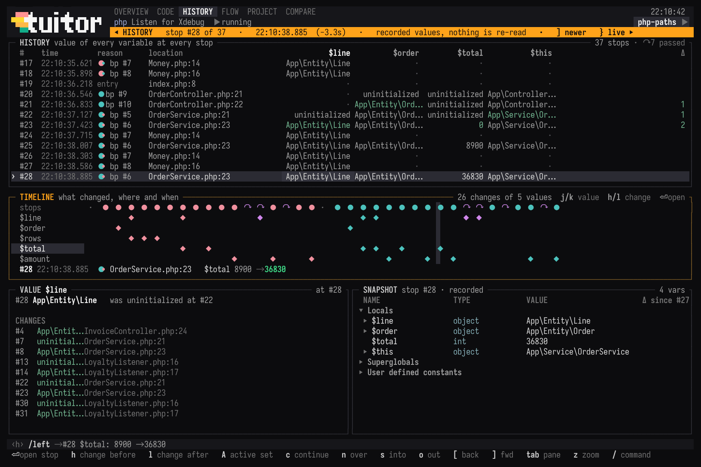
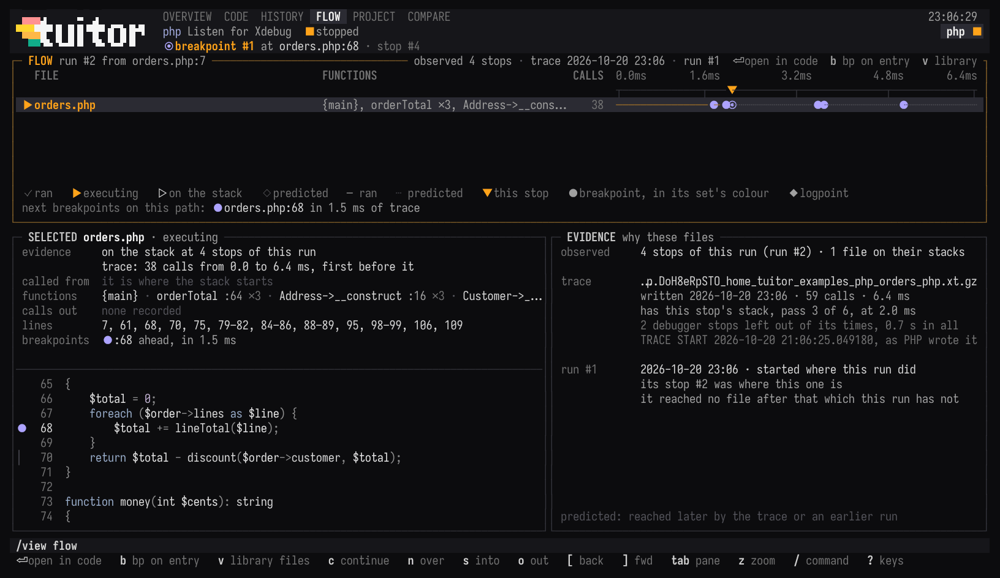
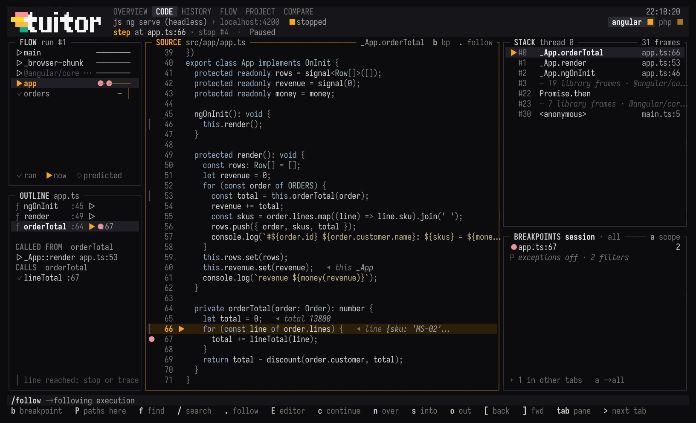
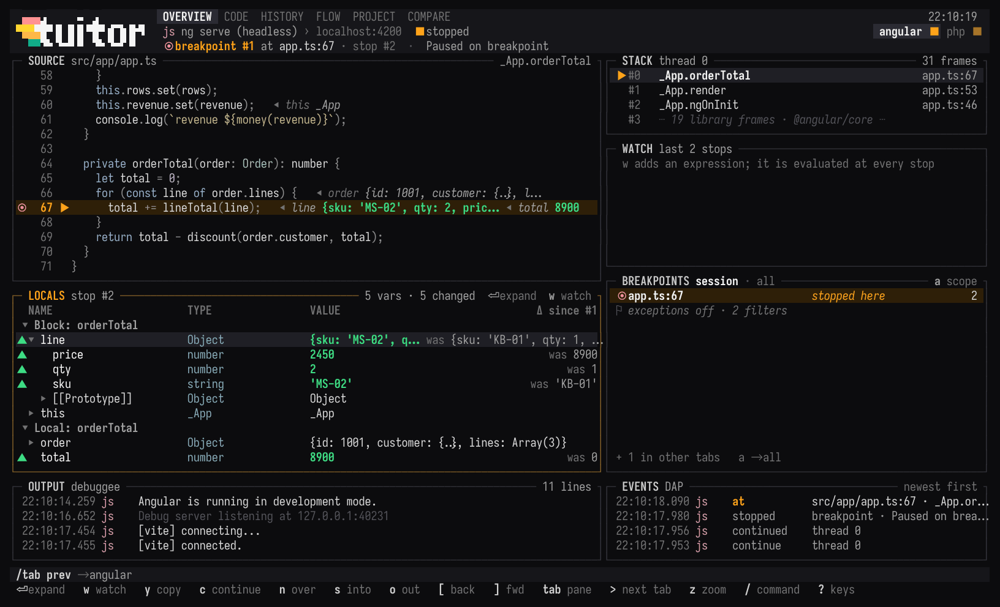
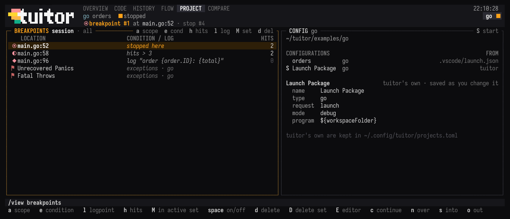
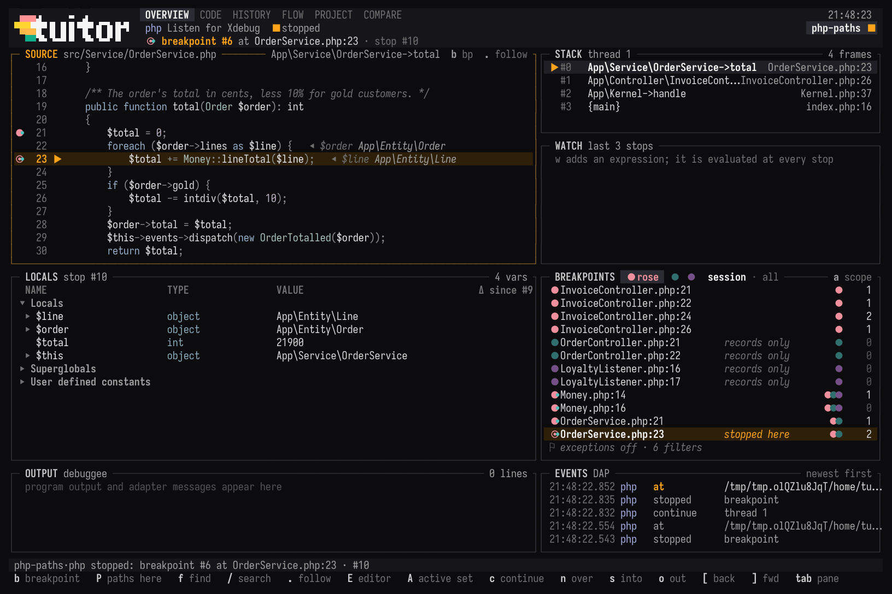
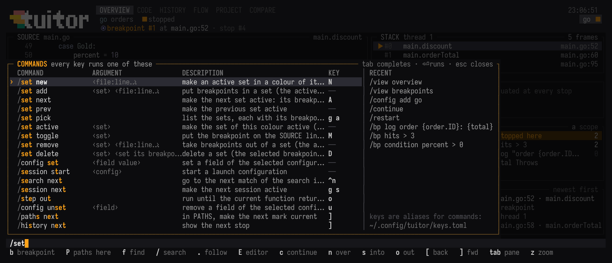
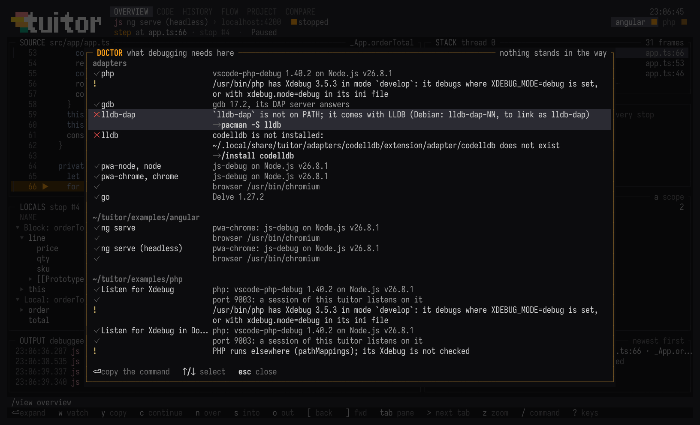

<picture>
  <source media="(prefers-color-scheme: dark)" srcset="assets/logo_white.svg">
  <source media="(prefers-color-scheme: light)" srcset="assets/logo_black.svg">
  
</picture>

tuitor is a terminal debugger that works through the Debug Adapter Protocol (DAP), so one
client covers many languages: it knows vscode-php-debug with Xdebug, js-debug, Delve, gdb,
lldb-dap and CodeLLDB, and `adapters.toml` adds others. It shows a stopped program on one
screen: source with values inline, stack, locals with what changed since the previous
stop, watches, breakpoints, output and protocol events. Every stop is recorded, so you can
step back through them and see when a value went wrong. Breakpoints go in sets told apart by
colour: one set stops the program, the others record the stop and let it go on. COMPARE lines
up what two sets recorded in two runs, and PATHS makes sets of the stages you choose in the
call trees a language server finds through a line, from where execution starts down past it.

It exists because there is no standalone, language-agnostic debugging client: a debugger
is either part of an IDE or made for one language or runtime (pdb for Python, Delve for
Go, gdb for native code). The adapters already speak one protocol; tuitor is a client for
all of them that needs only a terminal, next to whatever editor you use.



## Why not an IDE

tuitor needs a terminal and nothing else: no display server, window manager or GUI
toolkit, so it works wherever a terminal program does, SSH sessions and terminal
multiplexers included. The release binary links only libc, libm and libgcc_s. Started
inside Neovim's terminal, `E` opens files in that Neovim.

It is also small. Sizes measured on 2026-10-20, x86_64 Linux (Arch), in MB of 10⁶ bytes:

| | version | MB |
|---|---|---:|
| tuitor, `cargo build --release` (x86_64-unknown-linux-gnu, symbols kept) | 0.1.0 | 11.3 |
| tuitor, after `strip` | 0.1.0 | 8.9 |
| vscode-php-debug, unpacked | 1.40.2 | 5.8 |
| Xdebug, `xdebug.so` (Arch package) | 3.5.3 | 0.4 |
| js-debug DAP server, unpacked | 1.140.0 | 2.6 |
| Delve, `dlv` as `go install` builds it | 1.27.2 | 24.6 |
| gdb, `/usr/bin/gdb` (Arch package) | 17.2 | 31.9 |
| Node.js, `/usr/bin/node` (Arch package) | 26.8.1 | 63.3 |
| VS Code, Linux x64 `.tar.gz` from code.visualstudio.com | 1.142.0 | 345.7 |
| VS Code, unpacked | 1.142.0 | 1016.5 |

Debugging PHP and JavaScript with tuitor takes 20 MB on top of Node.js, which both
adapters run on and most development machines already have. VS Code needs the
same adapters: its PHP Debug extension is vscode-php-debug, and its JavaScript debugger is
js-debug (VS Code 1.142.0 ships js-debug 1.140.0).

## Install

From a clone of this repository, with a stable Rust toolchain (tested with 1.96):

```sh
cargo install --path crates/tuitor
```

### Installing adapters

tuitor runs adapters; it does not bundle them. `tuitor doctor` lists every adapter, what
it found and what is missing, with the command that fixes it. `tuitor install <adapter>`
(`/install` in tuitor, `i` on a configuration in CONFIG) says what it downloads from
where, asks, fetches the release its authors publish with curl, unpacks it into tuitor's
adapter directory and checks it as starting a session does:

| language | adapter | install | from |
|---|---|---|---|
| PHP | vscode-php-debug 1.40.2, on Node.js 20.18+ | `tuitor install php` | [xdebug/vscode-php-debug](https://github.com/xdebug/vscode-php-debug/releases) `.vsix` |
| | Xdebug 3, loaded by PHP | distribution package, `pie install xdebug/xdebug` | [xdebug.org](https://xdebug.org/docs/install) |
| JavaScript, TypeScript (Node.js, Chrome, Chromium) | js-debug 1.140.0, on Node.js | `tuitor install js-debug` | [microsoft/vscode-js-debug](https://github.com/microsoft/vscode-js-debug/releases) DAP server `.tar.gz` |
| Go | Delve | `tuitor install delve` (runs `go install`) | [go-delve/delve](https://github.com/go-delve/delve) |
| C, C++, Rust, Zig | gdb 14+ built with Python | distribution package | |
| | lldb-dap | distribution package (LLVM) | |
| | CodeLLDB 1.12.3 | `tuitor install codelldb` | [vadimcn/codelldb](https://github.com/vadimcn/codelldb/releases) `.vsix` |

For gdb, LLDB and Xdebug, which take root to install, `tuitor install` names the package
of your distribution (Arch, Debian and Ubuntu, Fedora) and checks what is there.
`--version` installs another release. The steps by hand, and what each adapter needs to
know, are in [docs/adapters.md](docs/adapters.md).

## Quick start

[`examples/`](examples) has one small program, which totals three orders, for each kind of
project, and `php-paths`, a PHP application with two controllers through one service, for
PATHS, sets and COMPARE. Each has a `.vscode/launch.json`, a README that walks through a
first session, and a `run.sh` that checks what the example needs, offers to install
js-debug, vscode-php-debug or Delve when they are missing, builds tuitor from this
repository and starts it on the example:

| example | debugged through | run |
|---|---|---|
| [`php`](examples/php) | Xdebug and vscode-php-debug, on the host or in Docker | `./run.sh`, `PHP=/path/to/php ./run.sh`, `TRACE=1 ./run.sh` |
| [`php-paths`](examples/php-paths) | Xdebug and vscode-php-debug, two requests; intelephense for PATHS | `./run.sh`, `PHP=/path/to/php ./run.sh` |
| [`js`](examples/js) | js-debug, in Node.js | `./run.sh` |
| [`typescript`](examples/typescript) | js-debug, in Node.js, through `tsc`'s source map | `./run.sh` |
| [`web`](examples/web) | js-debug, a page from disk in Chromium | `./run.sh`, `HEADLESS=1 ./run.sh` |
| [`angular`](examples/angular) | js-debug, `ng serve`'s page in Chromium | `./run.sh`, `HEADLESS=1 ./run.sh` |
| [`go`](examples/go) | Delve | `./run.sh` |
| [`c`](examples/c) | gdb | `./run.sh` |
| [`rust`](examples/rust) | gdb | `./run.sh` |

On your own code:

```sh
tuitor                                    # this directory's project, and its configuration if it has just one
tuitor "Listen for Xdebug"                # a configuration by name, from launch.json or tuitor's own
tuitor -C ~/shop/api --open ~/shop/web    # two projects, each in a tab
tuitor exec ./target/debug/app -- --flag  # a native program, through gdb
tuitor listen --map /var/www/app=./api    # PHP on port 9003, without a configuration
tuitor configs                            # the projects, configurations and adapters tuitor sees
```

### PHP in Docker

Xdebug connects out of the container to tuitor on the host. In `examples/php`, start
`tuitor "Listen for Xdebug in Docker"`, then `docker compose run --rm php` in another
terminal. For a service of your own:

```yaml
services:
  php:
    extra_hosts: ["host.docker.internal:host-gateway"]   # needed on Linux
    environment:
      XDEBUG_MODE: ${XDEBUG_MODE:-off}                    # XDEBUG_MODE=debug docker compose up -d
      XDEBUG_CONFIG: client_host=host.docker.internal client_port=9003
```

Then `tuitor listen --map /var/www/app=./api` (path in the container = path here), and a
request with the Xdebug trigger, or `XDEBUG_TRIGGER=1` for a CLI script. To keep the
mapping, `/config map /var/www/app=./api` puts it in a configuration of tuitor's own, and
`/config mappings-from-compose` (`M` in CONFIG) takes the bind mounts of the service that
runs PHP from `docker compose config`, or from `compose.yaml` and its override without
docker.

## Features

### One screen

OVERVIEW (`g o`, above) shows SOURCE, STACK, LOCALS, WATCH, BREAKPOINTS, OUTPUT and
EVENTS at once; `z` zooms one pane. Bright colour carries meaning: amber is where
execution is, green what changed at this stop, red an error. A breakpoint has the colour of
its set, and the one hit at the stop on view is `◉`.

LOCALS marks a changed value `▲` with the value it had before, and a value that reads the
same but changed inside, such as an object whose field changed or a pointer whose target
did, `△`. It shows the frame selected in STACK, compared with the same call at the
previous stop, and `x` evaluates in that frame. SOURCE shows the values beside the lines
that use them. Watches (`w`) are evaluated in the top frame at every stop, with the last
stops side by side and a trend.

### Recorded stops

Every stop is recorded with what was read there: the stack, the variables of the frames
looked at, the watches. `[` and `]` step through the recorded stops and `}` returns to
the live one; an older stop is shown read-only, and nothing is read from the program
again. HISTORY (`g h`) is every variable at every stop, with a chart of the value under
the cursor and the full snapshot of the stop.



Below the table, TIMELINE has a row for each value that changed, a watch or a variable of
the top frame, with a mark at each stop where it changed, in the colour of the breakpoint
set the stop was at, and the stops along the top: `●` where the program waited, `↷` where
it went on, `·` where no breakpoint stopped it. A value is compared with what it was at the
last stop in the same function, since watches too are read in the top frame. `j` and `k`
pick a value, `h` and `l` show the stop of its change before or after the one on view, with
what it was and became, and `enter` opens that stop in OVERVIEW. TIMELINE shows changes,
not whether they are wrong.



### FLOW

FLOW (`g f`) lists the files of a run in the order execution first reached them, with the
functions seen in each, as a waterfall over the stops, or over time when an Xdebug
function trace covers the run: `✓` ran, `▶` executes now, `▷` is further down the stack,
`◇` is still to come. It goes by:

- the stack of every stop of this run, with any adapter;
- earlier runs that started at the same stop, kept in `~/.local/state/tuitor/flows/`,
  which predict the files that come after this point (while vscode-php-debug listens,
  each request is a run);
- for PHP, the newest finished Xdebug trace that passes through the stack of the stop on
  view: it times every file, shows what the request does after this stop and the next
  breakpoints on its path. Times leave out the debugger's stops.

`enter` opens a file in CODE, `b` puts a breakpoint where it is entered, `v` lists library
files one by one.



Xdebug writes traces in `trace` mode, in the computerized format tuitor reads (`.xt`, or
`.xt.gz` when Xdebug compresses them):

```ini
xdebug.mode = debug,trace
xdebug.start_with_request = trigger    ; XDEBUG_TRIGGER (cookie, query, environment) starts both
xdebug.trace_format = 1
xdebug.output_dir = /tmp/xdebug
xdebug.trace_output_name = trace.%u.%R ; a file per request: the time and the URI
```

`/config set xdebugTraceDir /tmp/xdebug` tells tuitor where they are (a field of tuitor's
own, which the adapter ignores). A trace is complete once its request has finished: trace
a request, then debug the next one that takes the same path. A directory in a container
is mapped like the code, through `pathMappings`. `TRACE=1 ./run.sh` in
[`examples/php`](examples/php) traces its run, and its README does the same in Docker.

### CODE and OUTLINE

CODE (`g c`) has SOURCE with the whole stack and the breakpoints, and on the left FLOW
above OUTLINE: the functions of the file in SOURCE (PHP, JavaScript and TypeScript, Rust,
C, Go), whether each ran, where the one at the cursor was called from and what it calls.
SOURCE marks with `│` the lines a stop or a trace reached. A frame whose source the adapter
has itself, such as Node's internals, shows the adapter's text, read-only.



### Projects and tabs

A tab is one project: its directory, launch configurations, debug sessions, views and
history. The debuggers of different tabs never mix. The top bar lists the tabs with the
state of each one's session (`■` stopped, `▶` running, `⧗` starting, `✕` ended). `O`
opens a project, picked from those opened recently as you type or given as a directory;
`T` adds a tab, `<` and `>` switch, `ctrl-w` closes one, asking first while its session is
live. js-debug's child sessions (each Node process, each page) show as part of the session
that started them, and frames of libraries fold into one line in STACK (`v` unfolds).



### Breakpoints and configurations

PROJECT (`g p`) has BREAKPOINTS and CONFIG side by side. A breakpoint can stop only when a
condition holds (`e`), stop on some hits only (`h`, in the adapter's terms: `>= 3` in
js-debug, `% 2` in vscode-php-debug, `> 2` in Delve, and for gdb the number of hits to
pass over), or log a message instead of stopping (`l`, `{expr}` is interpolated). `space`
turns one off, `a` lists those of every tab. The shape of a breakpoint is what it does: `●`
stops, `◐` has a condition or a hit count, `◆` logs, `○` is disabled, `◌` was not taken by
the adapter, and `◉` is the one the stop on view hit. Breakpoints and watches are kept per
project in `~/.local/state/tuitor/`, outside the repository.



CONFIG lists the project's launch configurations: those of `.vscode/launch.json`, read as
VS Code reads it and never written, and tuitor's own, kept outside the repository in
`~/.config/tuitor/projects.toml` and changed with `/config` (`set`, `unset`, `map`,
`mappings-from-compose`, `add`, `delete`). A project with none gets one for its kind when it
is opened. The commands and the defaults are in [docs/configuration.md](docs/configuration.md).

### Breakpoint sets

Every breakpoint is in one set or more, and a set has no name but a colour, chosen when it is
made to stay apart from the other sets' and from amber, green and red, so that there can be any
number of sets. The breakpoints of the active set stop the program. A breakpoint only in
other sets records the stop, with the stack, the top frame's variables and the watches, and
the program goes on by itself. Sets share breakpoints: two ways into one service can each have
a set, both with the service's breakpoints. `N` makes a set and `A` makes the next one active,
also while the program runs, and `g a` lists the sets to pick one; `M` puts the breakpoint
selected, or on the SOURCE line, in the active set or takes it out, `D` in BREAKPOINTS deletes a
set, and `b` adds to the active set.



A breakpoint has the colour of the active set when it is in it, else of the first set it
joined: full when it stops the program, dimmer when it only records, with a smaller `•` in
another set's colour when it is in more sets. HISTORY marks the stops the program went on from
with `↷`. A hit that only records costs what reading the stop costs, for which tuitor asks for
the variables and the watches together, a level at a time: measured per hit on the C, PHP and
JavaScript examples, 4 to 6 ms with gdb, 3 to 5 ms with Xdebug and about 260 ms with js-debug.
The commands and the details are in [docs/sets.md](docs/sets.md).

### Comparing sets

COMPARE (`g d`, `/compare`) lines up what two sets recorded, each in a run of its own, such as
one set in one request and another in the next. A hit of a breakpoint the sets share lines up
with the same hit on the other side, and its row counts the values that differ, appear or
disappear; VALUES lists them for the hit under the cursor. A hit only one side has is listed
with what it read. `/compare lavender cyan` names the sets and `/compare cyan@3 cyan@5` one set in
two of FLOW's runs; `[` and `]` take a side from an older or newer run, and `enter` opens the
breakpoint in CODE or a side's stop in HISTORY.


### Paths through a line

`P` (`/paths`) asks the project's language server for the call trees through the function the
SOURCE line is in. Up, it follows the callers to where execution starts: a controller, `main`,
a test, a script's top level, or a function no code calls, which a framework or an event does.
Down, from that place, from every function on the way and from the line's function, it follows
what each one calls in the project, up to three calls further, so that a path does not end at
the line: a controller loads the order before the service totals it and formats the total
after. PATHS shows a tree per place execution starts, with the line's function marked `◆`
wherever it is called and `⋔` where the paths through it part. Under the trees are the lines
of the stage under the cursor worth a breakpoint: its entry, its calls into the stages chosen
below it, the last writes and calls into the project before those, and the line asked about.
Calls no server can see, such as an event dispatcher's, come from the stacks of the runs FLOW
remembers and show as `⇢`.

Nothing is marked at first. `m` marks the end-to-end path through the stage under the cursor,
from where it starts down to a call with nothing below it, and gives the mark a set's colour;
`space` puts one stage in the current mark or takes it out, `b` a stage and everything below
it, and `[` `]` go from mark to mark. `enter` makes each mark a breakpoint set, so that a line
two marks share is one breakpoint in both sets, where COMPARE lines the paths up. PATHS says
what its limits cut short and what no server sees in the language: a container's, a router's or
an event's calls, Angular's template bindings, calls through interfaces.


tuitor runs intelephense (PHP), typescript-language-server (TypeScript, JavaScript, Angular),
rust-analyzer (Rust) and gopls (Go), from `PATH` or as the `[lsp]` table of
[`config.toml`](docs/configuration.md#configtoml) says, once per project when first asked, and
ends them with the tab. Support for other language servers is welcome as a contribution:
[`crates/tuitor-code`](crates/tuitor-code) is the one crate that speaks LSP.

### Commands

Every key runs a command line. `/` opens the command line (`:` too, and in SOURCE only
`:`), which matches commands as you type, completes them with `tab`, shows the argument
each takes and lists the recent command lines; a number alone goes to that line of SOURCE
(`:42`). `?` lists every command with its key.



- `f` finds files and breakpoints (`name:line`).
- A command's `file:line`, as in `/bp toggle LoyaltyListener.php:16`, names a file from the
  project's directory or by the end of its path, `Event/LoyaltyListener.php` say, when one
  file of the project, outside what `.gitignore` leaves out, ends that way.
- `/` in SOURCE, as in vim, and `ctrl-f` anywhere search the file in SOURCE as you type,
  ignoring case unless the search has a capital letter; `ctrl-n` and `ctrl-p` go to the
  next and previous match.
- `shift-down` and `shift-up` scroll SOURCE a page, as `ctrl-f` and `ctrl-b` do in vim,
  keeping the cursor on the screen.
- `enter` on a line of OUTPUT or EVENTS that names a file and a line opens it in CODE:
  PHP's errors and stack traces, Node's stack frames, Rust's panics, Go and C locations.
  A path of a program in a container goes through the session's `pathMappings`.
- `E` opens the SOURCE line, or the selected breakpoint, in your editor: the `editor`
  command of `config.toml`; else, inside Neovim's terminal, that Neovim, beside tuitor;
  else `$VISUAL` or `$EDITOR` in tuitor's terminal until it exits.

### Doctor

`tuitor doctor`, and `!` in tuitor, check what debugging needs on this machine: each
adapter and what it runs (Node.js and its version, gdb's DAP server, Delve, a browser),
and for each configuration of the open projects, its adapter, the browser it starts, a
free port to listen for Xdebug on and Xdebug in the PHP that runs the program. Whatever is
missing comes with the command that fixes it: in DOCTOR, `enter` copies a shell command,
puts a tuitor command on the command line or opens INSTALL, and tuitor runs nothing
without asking. `tuitor doctor` exits with 1 when something the project, or an adapter
named (`tuitor doctor php gdb`), needs is missing.



## Keys

| key | action | key | action |
|---|---|---|---|
| `c` `n` `s` `o` | continue, step over, in, out | `b` | toggle a breakpoint on the SOURCE line |
| `N` `A` `g a` | new breakpoint set, next set active, list of sets | `M` | breakpoint in or out of the active set |
| `P` | paths through the SOURCE line, to make sets of | | |
| `p` `X` `R` | pause, stop, restart | `f` | find files and breakpoints |
| `S` | start the configuration selected in CONFIG | `ctrl-f`, in SOURCE `/` | search SOURCE |
| `[` `]` `}` | older stop, newer, live | `w` `x` | watch, evaluate |
| `g o` `g c` `g h` `g f` `g p` `g d` | OVERVIEW, CODE, HISTORY, FLOW, PROJECT, COMPARE | `E` | open in your editor |
| `tab` `z` | next pane, zoom the pane | `y` | copy the selection (OSC 52) |
| `j` `k` `h` `l`, arrows | move, collapse, expand | `.` | SOURCE follows execution again |
| `shift-down` `shift-up` | scroll SOURCE a page | `:42` | go to line 42 of SOURCE |
| `<` `>` | previous, next tab | `O` `T` `ctrl-w` | open a project, new tab, close tab |
| `g s` `g S` | next, previous session of the tab | `!` | doctor |
| `q` `esc` | back out of a popup, zoom, history | `/` `:` `?` | command line, all commands |
| `Q` `ctrl-c` | quit | `enter` | expand, open, start |

In a pane: BREAKPOINTS `a` this session or all, `e` condition, `h` hit count, `l` log,
`space` on/off, `d` delete, `D` delete its set; CONFIG `a` add, `m` map a path, `M`
mappings from compose, `u` unset, `d` delete, `i` install the adapter; STACK and FLOW `v`
library frames or files; WATCH `d` delete; OUTPUT `C` clear; SOURCE `/` search, `ctrl-n`
`ctrl-p` next and previous match, `q` clears the search; COMPARE `[` `]` an older, newer run;
PATHS `m` mark the path, `space` a stage in or out, `b` a branch in or out, `u` unmark, `[` `]`
the mark before or after, `h` `l` fold and unfold, `enter` make the sets.

## Configuration

| file | |
|---|---|
| `~/.config/tuitor/keys.toml` | key bindings over the [defaults](crates/tuitor/src/default_keys.toml) |
| `~/.config/tuitor/adapters.toml` | adapters: replace a built-in one, or add one |
| `~/.config/tuitor/projects.toml` | tuitor's own launch configurations, by project path; written by `/config` |
| `~/.config/tuitor/config.toml` | the editor `E` runs; the language servers `P` asks |
| `~/.local/state/tuitor/` | breakpoints and their sets, watches, recent projects and runs; `tuitor.log` |
| `~/.local/share/tuitor/adapters/` | what `tuitor install` unpacks |

The directories follow `$XDG_CONFIG_HOME`, `$XDG_STATE_HOME` and `$XDG_DATA_HOME` (macOS:
`~/Library/Application Support/tuitor`). `TUITOR_LOG=dap=trace` logs the protocol. The
formats of the files, with examples, are in [docs/configuration.md](docs/configuration.md).

## Architecture

```
crates/tuitor-dap    DAP framing, message types, async client. Knows nothing about tuitor.
crates/tuitor-core   Engine: sessions, breakpoints, snapshots, deltas, flows and traces,
                     doctor, install. No terminal.
crates/tuitor-code   Language servers: the call paths to a line and the lines on them. The
                     only crate that speaks LSP.
crates/tuitor        The TUI: tabs, commands, keymap, views.
```

Each tab owns an engine, which owns all of its project's debugger state. The engines are
driven from one loop; DAP responses come back as messages, labelled with their tab on the
way into the loop, so the state needs no locks, and the UI draws every frame from it. Keys
map to command lines, command lines parse into actions, and actions are applied in one
place (`App::apply`), so a key, the command line and a script do the same thing.

## Development

```sh
cargo test --workspace                       # includes a real gdb session
TUITOR_PHP=/path/to/php-with-xdebug \
TUITOR_PHP_ADAPTER=~/.local/share/tuitor/adapters/vscode-php-debug/extension/out/phpDebug.js \
cargo test -p tuitor-core --test php -- --ignored
TUITOR_JS_ADAPTER=~/.local/share/tuitor/adapters/js-debug/js-debug/src/dapDebugServer.js \
cargo test -p tuitor-core --test js -- --ignored
TUITOR_DLV="$(go env GOPATH)/bin/dlv" cargo test -p tuitor-core --test go -- --ignored
TUITOR_GOPLS=gopls TUITOR_RUST_ANALYZER=rust-analyzer TUITOR_INTELEPHENSE=intelephense \
TUITOR_TYPESCRIPT_LANGUAGE_SERVER=typescript-language-server \
cargo test -p tuitor-code --test servers -- --ignored
```

`tuitor --script file` runs command lines and `@` directives without a terminal and saves
screens as ANSI (`cat` them); see `crates/tuitor/src/script.rs`. Every example's `run.sh`
passes its arguments on (`./run.sh --script demo.tsc`), and
[`docs/screenshots/render.sh`](docs/screenshots/render.sh) makes the pictures above that
way.

## Limitations

- A program that needs a terminal of its own (the adapter's `runInTerminal` request, as
  `"console": "integratedTerminal"` makes js-debug send) is refused; use
  `"internalConsole"`.
- VS Code's `preLaunchTask` is not run: start a dev server or a build yourself.
- STACK shows the thread that stopped; there is no list of threads to switch to.
- No function or data breakpoints, disassembly, memory view, or setting a variable.
- COMPARE has values only for the runs of the tuitor that is running: recorded stops are not
  saved, and FLOW remembers earlier runs by their stacks alone.
- PATHS asks one of four language servers, so it covers PHP, TypeScript and JavaScript, Rust
  and Go; C and C++ have none. It sees what the server sees: calls a framework makes by name, an
  event dispatcher's and those through interfaces come only from runs FLOW remembers, and
  rust-analyzer reports no call inside a macro's arguments.
- tuitor draws with truecolour and Unicode symbols; a terminal or console font without
  them shows approximate colours and missing glyphs.
- Developed and tested on Linux; macOS and Windows are untested.
